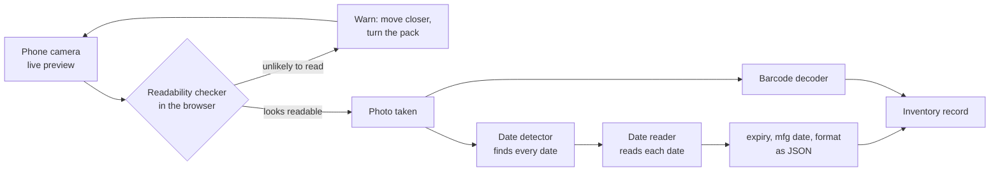
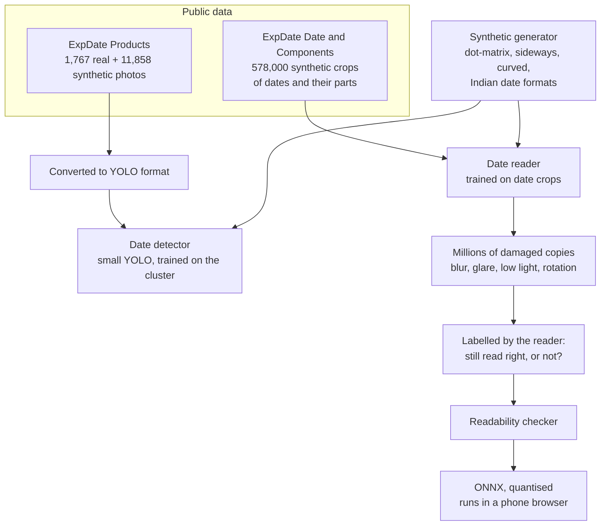
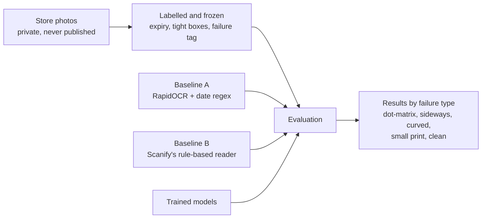
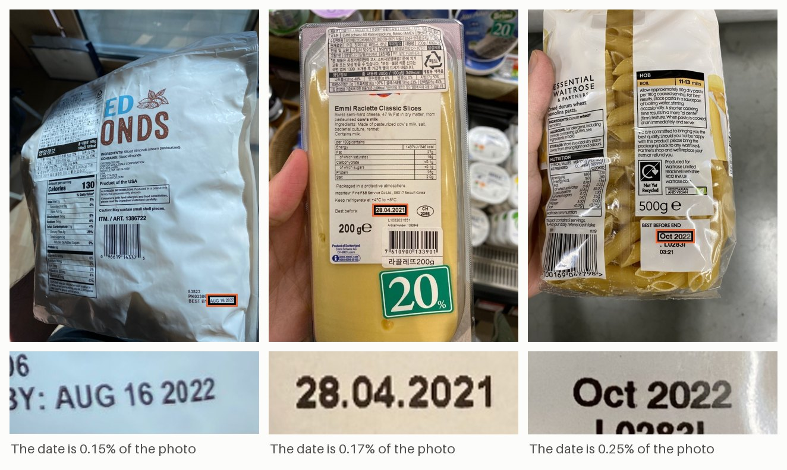
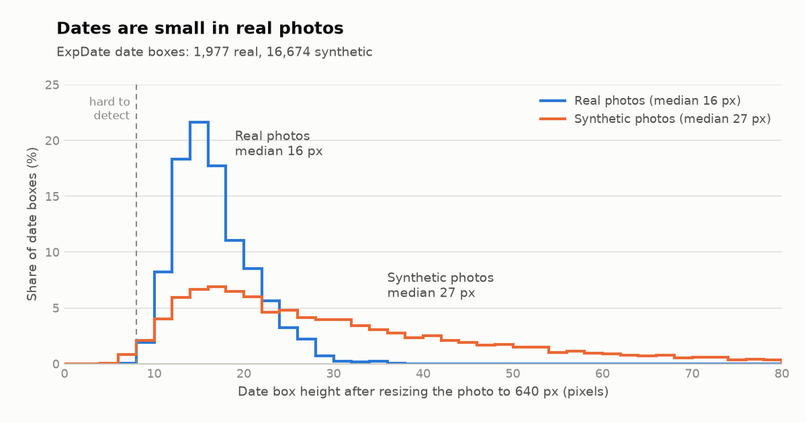

# BestBefore

**Reading expiry dates on product packaging, and knowing before the photo
is taken whether the date will be readable.**

BestBefore trains two small models: a **date reader**, which finds every
date printed on a pack and reads the expiry as day / month / year, and a
**readability checker**, small enough to run on a phone's live camera
preview, which warns when the photo about to be taken won't be readable.
They're trained on public data on a university GPU cluster and tested on
real photos taken in retail stores.


<sub>Expiry dates from the ExpDate test set, each hard to read in a
different way. Photos: ExpDate (KIST, CC BY 4.0), cropped.</sub>

---

## Where this started

During an internship at a pet-supplies retailer, I built **Scanify**, a
stock-taking app. The retailer's inventory system has no expiry dates, so
staff photograph each pack and the app reads two things from the photo:
the barcode (`zxing-cpp`) and the printed expiry date (`RapidOCR`
followed by a hand-written, rule-based date parser).

Measured on the store photos, the rules got a long way, then hit a wall:

| | Photos |
|---|---:|
| Expiry read right | 32 of 44 |
| Expiry missed | 12 |
| Expiry read wrong | 0 |

Every miss came from **reading** the print, not from parsing the text:
the parser extracted every date the OCR returned. The misses were
dot-matrix print on curved caps and jar bottoms, dates stamped sideways,
small print, and a few large, clear "Best Before" lines the OCR skipped
entirely.

A blur score (variance of the Laplacian) was tried as an early warning
and **did not** predict failures: photos that were read and photos that
were missed scored the same. It measured how much fine detail was in the
frame, not whether the date could be read.

BestBefore replaces the hand-written rules with trained models, starting
exactly where the rules ran out.

---

## How it fits together

### In the store

The checker runs on every frame of the camera preview, so staff are told
to move closer or turn the pack **before** taking the photo. Once a photo
is taken, the detector finds the dates and the reader reads them.



### How the models are built



The checker learns from the reader itself. Each damaged copy is labelled
by whether the reader still gets the date right, so the checker learns
what actually makes reading fail, rather than a proxy like blur.

### How it is judged



---

## Measuring success

Success is a results table **broken down by failure type**, not one
headline number. Each store photo carries one tag: `dot-matrix`,
`sideways`, `curved`, `small-print`, `other-face` (the date is on another
side of the pack) or `clean`.

| Model | Metric |
|---|---|
| Date detector | recall and mAP@0.5; on store photos, was the expiry found (IoU of at least 0.5)? |
| Date reader | exact day, month and year (month and year when the pack prints no day). **Wrong reads are counted separately from no reads.** |
| Readability checker | AUROC for "will be read right", plus agreement with OCR accuracy on SmartDoc-QA and with sharpness ratings on SPAQ |

A wrong date is worse than no date. Reading `08/2027` as `08/2021` would
mark a whole batch as expired, while a missed date only means typing it in.

### Baselines

Every model has to beat both of these on the same photos:

- **A. RapidOCR off the shelf, plus a simple date regex.** Public and
  reproducible by anyone.
- **B. Scanify's reader**, the rule-based system above, called from its
  own repository.

---

## Roadmap


| | Milestone | Done when | Status |
|---|---|---|---|
| M0 | Data and test set | baseline table on ExpDate and on the store photos, by tag | **done** |
| M1 | Date detector | recall and mAP@0.5 on ExpDate test; expiry found on store photos | **done** |
| M2 | Synthetic generator | an ablation showing what synthetic data adds on the store photos | **done** |
| M3 | Date reader | end-to-end date accuracy vs baselines A and B, by tag | next |
| M4 | Readability checker | AUROC on held-out copies; SmartDoc-QA and SPAQ agreement; store photos | planned |
| M5 | On the phone | size, latency per frame, accuracy kept after quantising | planned |

### Progress so far

ExpDate is downloaded, checked, measured and converted to YOLO format.
Looking at the data turned up three things that shape the next
milestones:

- **The dates are small.** In real photos the median date box covers
  0.45% of the frame, about 16 px tall at YOLO's default 640 px input.
  M1 compares 640 and 1280 px on a validation split.
- **ExpDate has almost no sideways dates** (0% of real date boxes), and
  half its test set uses the Korean `YYYY.MM.DD` format. The M2 generator
  has to supply sideways dates and the Indian formats seen in stores
  (`April 2031`, `20260518`, `MM/YYYY-MM/YYYY` ranges).
- **The synthetic photos pair PROD and EXP dates at random,** so they
  teach where dates are, not which one is the expiry.



<picture>
  <source media="(prefers-color-scheme: dark)" srcset="docs/assets/date_box_sizes_dark.png">
  
</picture>

<sub>Synthetic dates are bigger, and so easier, than real ones. That is
why M1 keeps the real photos in training and measures what the
synthetic ones add. Photos: ExpDate (KIST, CC BY 4.0), boxes drawn and
cropped.</sub>

Details: [`docs/datasets.md`](docs/datasets.md).

### M0 result: the baselines to beat

Both readers were scored on the frozen store test set (87 photos with an
expiry in frame) and on ExpDate's test split, with one rule: **right** is
the exact date (month and year when the pack prints no day), **wrong** is
any other date, **none** is no date.

| Store photos | n | A right | A wrong | A none | B right | B wrong | B none |
|---|---:|---:|---:|---:|---:|---:|---:|
| sideways | 16 | 6 | 5 | 5 | 9 | 0 | 7 |
| dot-matrix | 21 | 7 | 0 | 14 | 7 | 0 | 14 |
| small-print | 17 | 14 | 2 | 1 | 16 | 0 | 1 |
| clean | 33 | 22 | 5 | 6 | 28 | 2 | 3 |
| **all** | **87** | **49** | **12** | **26** | **60** | **2** | **25** |
| **ExpDate test** | **655** | **502** | **28** | **125** | **57** | **6** | **592** |

A is RapidOCR plus a date regex, taking the latest date found. B is
Scanify's reader; this harness reproduces Scanify's own measurement on
its 44 photos exactly (32 right, 0 wrong, 12 none). Full table and run
records: [`results/m0_baselines.md`](results/m0_baselines.md).

What it shows:

- **On the store photos, Scanify's rules pay off.** B reads 60 of 87
  and gets only 2 wrong (both a `19th December 2026`: its rules skip the
  ordinal and answer the month's last day). A reads 49 and gets 12
  wrong, every one an earlier date taken for the expiry: OCR missed the
  real one, or the pack prints only a mfg date and a shelf life.
- **On ExpDate, the order flips: A reads 502 of 655, B only 57.** B's
  OCR does see the dates: of the 448 photos A read right and B returned
  nothing for, 412 have the true date in B's own OCR text. But B's rules were written for Indian
  packs and expect an "EXP" label or an Indian format, so an unlabelled
  Korean `2021.08.03` gets "none". Hand-written rules fit the photos they
  were written for.
- **Dot-matrix is the wall for both:** 7 of 21, and the 14 others give
  no date at all, because the OCR finds no date text. That is a reading
  problem, which is what M3's trained reader is for.
- **The bar for M3:** beat B's 60 of 87 on the store photos without
  more wrong reads, and beat A on ExpDate.

### M1 result: a detector that finds ExpDate's dates, not yet the stores'

A small YOLO (`yolo11n`, 640 px), fine-tuned on ExpDate on the university
cluster's H100s. The model size, input size, training data and confidence
threshold were all chosen on validation photos; each test set was scored
once, with three training seeds.

| Expiry dates found | ExpDate test | Store photos |
|---|---:|---:|
| the M1 detector (seed 0) | 637 of 665 | 18 of 81 |
| mean of 3 seeds | 97.1% | 26.7% |

By store failure tag (mean of 3 seeds): dot-matrix 73%, clean 23%,
sideways 0 of 15, small print 0 of 15. The boxes it does keep are
nearly all real dates: precision 0.97 to 0.99 on ExpDate, 0.93 to 0.95 in
the stores.

The gap is the finding. ExpDate's dates are numeric, upright and fairly
large, and the detector learned exactly that:

- **Sideways dates:** none in ExpDate, none found.
- **Month written as a word** (`December 2026`): 6% of ExpDate's real
  dates and 48% of its synthetic ones, all three-letter abbreviations
  (`DEC`), against 26 of the 66 upright store expiries, most of them full
  names. The detector finds 3% of the store's.
- **Print size:** numeric store dates are found 87% of the time when
  printed at ExpDate's size, 12% when under 1.5% of the photo.

That sets M2's job: synthetic dates that are sideways, month-named and
small, and a larger input (or tiles) for small print, judged on the store
photos by tag. Full report:
[`results/m1_detector.md`](results/m1_detector.md); the analysis of the
misses: [`experiments/m1-store-misses`](experiments/m1-store-misses/README.md).

### M2 result: generated dates double the store expiries found, but not the sideways ones

The same small YOLO, retrained on six kinds of training data, each with
the same budget of 2.56 million training images and three seeds: M1's
data (`base`); plus ExpDate's photos turned 90° or 270° (`rot`); plus
50,000 photos with generated dates drawn onto ExpDate's training photos
(`gen`); both (`gen-rot`); both at a 1,280 px input (`gen-rot-1280`); and
10,000 generated photos instead of 50,000 (`gen10k`). The generator draws
dates in solid, dot-matrix, label and embossed print, in Indian formats
with the month as a word or a number, small, sideways, tilted and on
curved surfaces, then adds blur, noise, glare and uneven light. Every box
comes from the ink it drew. A rule written before any run chose the M2
detector on validation photos: `gen-rot-1280`, seed 0. ExpDate test and
the store photos were each scored once, afterwards.

| Expiry dates | ExpDate test, found | Store photos, found | Store, boxed at any confidence | Store precision |
|---|---:|---:|---:|---:|
| the M1 detector (seed 0) | 637 of 665 | 18 of 81 | 43 | 0.950 |
| M1, mean of 3 seeds | 646 | 21.7 | 45 | 0.939 |
| the M2 detector (seed 0) | 662 of 665 | 39 of 81 | 69 | 0.902 |
| M2 (`gen-rot-1280`), mean of 3 seeds | 662.7 | 46 (39 to 53) | 70.3 | 0.910 |

By store failure tag (mean of 3 seeds), M1 then M2: sideways 0 then 2.7
of 15, dot-matrix 14.7 then 19 of 20, small print 0 then 5.3 of 15, clean
7 then 19 of 31.

What it shows:

- **The generated dates are what helps.** With them (`gen` against
  `base`), clean store expiries go from 9.3 to 18.3 of 31, and full month
  names (`December 2026`) from 1 to 6.7 of 19. ExpDate's photos turned
  add nothing on the store photos (`rot` 26.3 of 81, `base` 27).
- **Small print moved only at 1,280 px:** 5.3 of 15 small-print expiries,
  against 0 to 0.7 for every 640 px arm.
- **Nothing was lost on ExpDate:** the M2 detector finds 662 of 665 test
  expiries (M1's: 637), and every arm keeps a validation mAP@0.5 for
  dates of 0.990 to 0.995.
- **The M2 detector is its arm's weakest seed on the store photos:** 39
  of 81, where its arm's seeds range from 39 to 53. The seed was fixed
  before any run, so it stays; the spread says the store set is too small
  to tell seeds apart.

Where it doesn't beat M1:

- **Sideways dates are almost unsolved:** 2.7 of 15 store expiries,
  though ExpDate's validation photos turned sideways are found almost
  every time (`rot`: 183.7 of 187). Neither turned ExpDate photos nor
  generated sideways dates look like the store's sideways dates to the
  model; why is the next thing to find out.
- **More false boxes:** precision 0.910 against M1's 0.939, and 0.11
  false boxes a photo against 0.03. That is the price of a threshold
  chosen for recall.
- **The threshold still cuts many store dates:** 70.3 expiries get a box
  at some confidence, 46 are kept.
- **Predictions written before any run:** turned photos lifting sideways
  dates "a lot" (`rot`) and generated plus turned ones lifting them "the
  most" (`gen-rot`) both failed on the store photos. Month words "up a
  lot" held on generated validation photos (296.3 of 300 for `gen`) but
  only partly on the store (6.7 of 19 full names). Small print "up" with
  the generated photos held only at 1,280 px. "No loss on ExpDate" held
  for every arm.

The store set is small (15 sideways and 15 small-print expiries), and
M1's store result chose what M2 aimed at, so these store numbers are a
somewhat optimistic estimate for a new store. Full report, with every
arm by tag and by cause:
[`results/m2_detector.md`](results/m2_detector.md); the plan and every
slice's record:
[`docs/m2-synthetic-generator.md`](docs/m2-synthetic-generator.md).

---

## Lessons carried over from Scanify

These were measured before this project started, and shape its design:

- **Cropping hurts off-the-shelf OCR.** RapidOCR read fewer dates from
  perfect hand-drawn crops (25 of 44) than from the whole photo (31 of
  44). A detector feeding crops to the same OCR won't beat Scanify; the
  gain needs a reader trained on crops.
- **Heavy preprocessing hurts.** Adaptive thresholding made OCR worse;
  mild sharpening helped slightly. Models trained on natural photos want
  natural photos.
- **Resolution has a sweet spot.** For RapidOCR, a longest side of
  1000 px beat 1600, 2200 and the original size.
- **A blur score over the whole frame measures detail, not focus.** If
  blur is scored again, it should cover only the region around the text.

---

## Data

### ExpDate (training)

| Subset | Size | Used for |
|---|---|---|
| Products-Real | 1,767 real photos (1,102 train / 665 test) | finding dates |
| Products-Synth | 11,858 synthetic photos | finding dates, training only |
| Date-Synth / Date-Real | 128,000 synthetic + a real test set | finding day / month / year inside a date |
| Components-Synth / -Real | 450,000 synthetic + a real test set | reading the characters |

ExpDate is not redistributed here; `scripts/download_expdate.py` fetches
it from the authors' release and checks it against recorded SHA-256
hashes.

### Store photos (private)

99 photos taken in the retailer's stores (87 with the expiry in frame),
labelled with the expiry, a tight box around every date, and a failure
tag. **They are never committed and never published:** only aggregate
numbers appear in this repository, never a photo, a photo's name or a
picture drawn from one.

From M0 to M2 they were for testing only, frozen by their hash so they
couldn't change between experiments, and every store number above was
measured before any training on them. On 2026-10-28 the retailer's owner
allowed them to be used for training and to be shown to AI tools for
analysis; publishing them is still not allowed. Once a milestone trains
on them, a new set of store photos, labelled and frozen before that
training, becomes the test set.

### For testing the readability checker

- **SmartDoc-QA:** smartphone photos of documents with defocus, motion
  blur and bad lighting, each labelled with its OCR accuracy.
- **SPAQ:** 11,125 photos from 66 phones with human sharpness ratings.

---

## Getting started

Requires Python 3.11 or newer.

```bash
python3.11 -m venv .venv
source .venv/bin/activate
pip install -e ".[dev,download]"
cp .env.example .env          # then set the data paths
```

Prepare ExpDate:

```bash
python scripts/download_expdate.py products-real products-synth
python scripts/check_expdate.py               # counts and problems per split
python scripts/contact_sheet.py --set real-test --n 50 --seed 0
python scripts/box_stats.py real-train real-test synth
python scripts/expdate_to_yolo.py             # YOLO dataset under $EXPDATE_DIR/yolo
python scripts/readme_figures.py              # the figures in this README
pytest
```

Reproduce the M0 baselines. Baseline A on ExpDate needs only the steps
above; baseline B needs a checkout of Scanify, and the store runs need the
store photos, both private:

```bash
pip install -e ".[baselines]"                 # RapidOCR 1.2.3, as Scanify uses
python scripts/run_baseline.py --reader a --set real-test
python scripts/run_baseline.py --reader b --set real-test
python scripts/run_baseline.py --reader a --set store
python scripts/run_baseline.py --reader b --set store
python scripts/baseline_table.py              # writes results/m0_baselines.md
```

Train and score the M1 detector. Training runs on a GPU cluster
(Slurm job scripts in `slurm/`; setup and steps in
[`docs/m1-date-detector.md`](docs/m1-date-detector.md)). Scoring runs on
the laptop's CPU, from the trained weights:

```bash
pip install -e ".[train]"
python scripts/eval_detector.py --set real-test --runs n640 n640-seed1 n640-seed2
python scripts/eval_detector.py --set store --runs n640 n640-seed1 n640-seed2
python scripts/m1_report.py                   # writes results/m1_detector.md
```

Generate, train and score M2. The derived sets, the 52,100 generated
photos and the 18 training runs are made on the cluster by Slurm jobs
(steps in
[`docs/m2-synthetic-generator.md`](docs/m2-synthetic-generator.md), S1 to
S6): `slurm/m2_derive.sbatch`, `slurm/m2_generate.sbatch`, then two
`slurm/m2_gpu.sbatch` jobs that share one work queue
(`scripts/m2_chain.py`), train every run and score each on the
validation suite. Back on the laptop, with each run's `last.pt` copied
into `$CHECKPOINT_DIR/m2/<run>/weights/`:

```bash
pip install -e ".[train,synth]"
python scripts/fetch_fonts.py                 # the generator's 20 fonts, checked by SHA-256
python scripts/render_sheet.py                # every print style, to look at
scripts/pull_cluster_results.sh               # run records, suites, the chain's decisions
python scripts/eval_detector.py --set store --runs m2-{base,rot,gen,gen-rot,gen10k,gen-rot-1280}-s{0,1,2}
python scripts/eval_detector.py --set real-test --runs m2-gen-rot-1280-s{0,1,2}
python experiments/m2-ablation/summarise.py   # and the other m2-* experiments
python scripts/m2_report.py                   # writes results/m2_detector.md
```

Every script run writes a record (settings, git commit, seed, library
versions, and for the baselines a hash of the reader's code) to
`results/runs/`, so any number can be traced and reproduced. Runs on the
store photos write theirs to `data/store/runs/`, which never enters git.

---

## Repository layout

```
bestbefore/
├── docs/            milestone plans, dataset notes, learning guides, figures
├── src/bestbefore/  datasets, format conversion, synthesis, models, evaluation
├── scripts/         command-line entry points
├── slurm/           cluster job scripts (from M1)
├── experiments/     one folder per question: script + README (from M1)
├── tests/
├── data/            not in git: ExpDate, converted labels, store photos
└── results/         summary tables in git; per-run outputs are not
```

## Documentation

- [`docs/m0-data-and-test-set.md`](docs/m0-data-and-test-set.md): the M0
  plan, slice by slice
- [`docs/datasets.md`](docs/datasets.md): what is actually in ExpDate
- [`results/m0_baselines.md`](results/m0_baselines.md): the baseline
  table, with the runs it came from
- [`results/m1_detector.md`](results/m1_detector.md): the M1 detector's
  results, from validation to the store photos
- [`docs/learnings/m0.md`](docs/learnings/m0.md): the ideas behind each
  step, explained simply
- [`docs/m1-date-detector.md`](docs/m1-date-detector.md): the M1 plan,
  from cluster setup to the final evaluation
- [`docs/learnings/m1.md`](docs/learnings/m1.md): the cluster, Slurm,
  fine-tuning, precision, recall and mAP, explained simply
- [`docs/m2-synthetic-generator.md`](docs/m2-synthetic-generator.md): the
  M2 plan: the generator, the ablation and every slice's record
- [`results/m2_detector.md`](results/m2_detector.md): the M2 ablation's
  results, from the validation suite to the store photos

---

## Acknowledgements

This project uses the **ExpDate** dataset by the Korea Institute of
Science and Technology (KIST), released under
[CC BY 4.0](https://creativecommons.org/licenses/by/4.0/):

> Seker, A. C. & Ahn, S. C. (2022). *A generalized framework for
> recognition of expiration dates on product packages using fully
> convolutional networks.* Expert Systems with Applications, 203, 117310.

Dataset page: <https://felizang.github.io/expdate/index_expdate.html>

M2's generated photos are drawn onto ExpDate's training photos, so they
are ExpDate derivatives and are not redistributed either. The
generator's 20 font families are under the SIL Open Font License,
fetched from the Google Fonts repository at a pinned commit and checked
by SHA-256; they aren't redistributed here.
