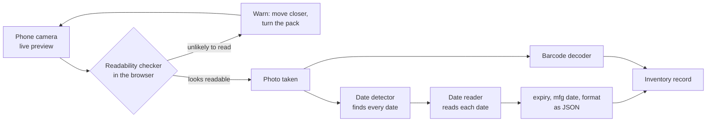
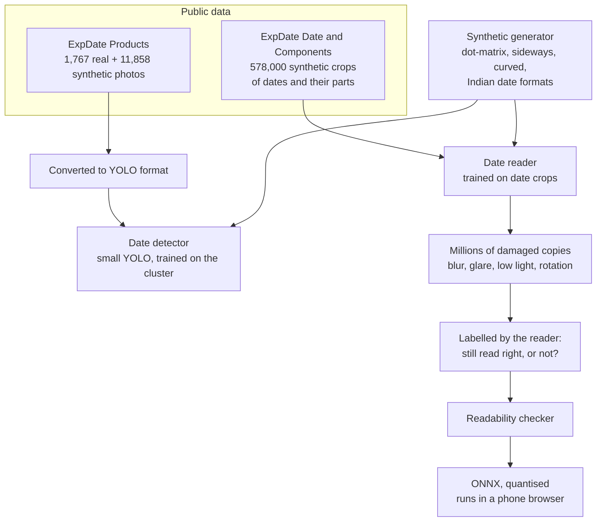
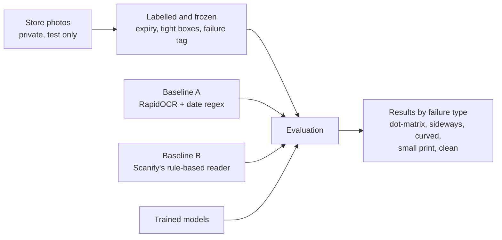

# BestBefore

**Reading expiry dates on product packaging, and knowing before the photo
is taken whether the date will be readable.**

BestBefore trains two small models: a **date reader**, which finds every
date printed on a pack and reads the expiry as day / month / year, and a
**readability checker**, small enough to run on a phone's live camera
preview, which warns when the photo about to be taken won't be readable.
They're trained on public data on a university GPU cluster and tested on
real photos taken in retail stores.

---

## Where this started

During an internship at a pet-supplies retailer, I built **Scanify**, a
stock-taking app. The retailer's inventory system has no expiry dates, so
staff photograph each pack and the app reads two things from the photo:
the barcode (`zxing-cpp`) and the printed expiry date (`RapidOCR`
followed by a hand-written, rule-based date parser).

Measured on the store photos, the rules got a long way, then hit a wall:

| | Photos |
|---|---:|
| Expiry read right | 32 of 44 |
| Expiry missed | 12 |
| Expiry read wrong | 0 |

Every miss came from **reading** the print, not from parsing the text:
the parser extracted every date the OCR returned. The misses were
dot-matrix print on curved caps and jar bottoms, dates stamped sideways,
small print, and a few large, clear "Best Before" lines the OCR skipped
entirely.

A blur score (variance of the Laplacian) was tried as an early warning
and **did not** predict failures: photos that were read and photos that
were missed scored the same. It measured how much fine detail was in the
frame, not whether the date could be read.

BestBefore replaces the hand-written rules with trained models, starting
exactly where the rules ran out.

---

## How it fits together

### In the store

The checker runs on every frame of the camera preview, so staff are told
to move closer or turn the pack **before** taking the photo. Once a photo
is taken, the detector finds the dates and the reader reads them.



### How the models are built



The checker learns from the reader itself. Each damaged copy is labelled
by whether the reader still gets the date right, so the checker learns
what actually makes reading fail, rather than a proxy like blur.

### How it is judged



---

## Measuring success

Success is a results table **broken down by failure type**, not one
headline number. Each store photo carries one tag: `dot-matrix`,
`sideways`, `curved`, `small-print`, `other-face` (the date is on another
side of the pack) or `clean`.

| Model | Metric |
|---|---|
| Date detector | recall and mAP@0.5; on store photos, was the expiry found (IoU of at least 0.5)? |
| Date reader | exact day, month and year (month and year when the pack prints no day). **Wrong reads are counted separately from no reads.** |
| Readability checker | AUROC for "will be read right", plus agreement with OCR accuracy on SmartDoc-QA and with sharpness ratings on SPAQ |

A wrong date is worse than no date. Reading `08/2027` as `08/2021` would
mark a whole batch as expired, while a missed date only means typing it in.

### Baselines

Every model has to beat both of these on the same photos:

- **A. RapidOCR off the shelf, plus a simple date regex.** Public and
  reproducible by anyone.
- **B. Scanify's reader**, the rule-based system above, called from its
  own repository.

---

## Roadmap


| | Milestone | Done when | Status |
|---|---|---|---|
| M0 | Data and test set | baseline table on ExpDate and on the store photos, by tag | in progress |
| M1 | Date detector | recall and mAP@0.5 on ExpDate test; expiry found on store photos | planned |
| M2 | Synthetic generator | an ablation showing what synthetic data adds on the store photos | planned |
| M3 | Date reader | end-to-end date accuracy vs baselines A and B, by tag | planned |
| M4 | Readability checker | AUROC on held-out copies; SmartDoc-QA and SPAQ agreement; store photos | planned |
| M5 | On the phone | size, latency per frame, accuracy kept after quantising | planned |

### Progress so far

ExpDate is downloaded, checked, measured and converted to YOLO format.
Looking at the data turned up three things that shape the next
milestones:

- **The dates are small.** In real photos the median date box covers
  0.45% of the frame, about 16 px tall at YOLO's default 640 px input.
  M1 compares 640 and 1280 px on a validation split.
- **ExpDate has almost no sideways dates** (0% of real date boxes), and
  half its test set uses the Korean `YYYY.MM.DD` format. The M2 generator
  has to supply sideways dates and the Indian formats seen in stores
  (`April 2031`, `20260518`, `MM/YYYY-MM/YYYY` ranges).
- **The synthetic photos pair PROD and EXP dates at random,** so they
  teach where dates are, not which one is the expiry.

Details: [`docs/datasets.md`](docs/datasets.md). The baseline table
follows at the end of M0.

---

## Lessons carried over from Scanify

These were measured before this project started, and shape its design:

- **Cropping hurts off-the-shelf OCR.** RapidOCR read fewer dates from
  perfect hand-drawn crops (25 of 44) than from the whole photo (31 of
  44). A detector feeding crops to the same OCR won't beat Scanify; the
  gain needs a reader trained on crops.
- **Heavy preprocessing hurts.** Adaptive thresholding made OCR worse;
  mild sharpening helped slightly. Models trained on natural photos want
  natural photos.
- **Resolution has a sweet spot.** For RapidOCR, a longest side of
  1000 px beat 1600, 2200 and the original size.
- **A blur score over the whole frame measures detail, not focus.** If
  blur is scored again, it should cover only the region around the text.

---

## Data

### ExpDate (training)

| Subset | Size | Used for |
|---|---|---|
| Products-Real | 1,767 real photos (1,102 train / 665 test) | finding dates |
| Products-Synth | 11,858 synthetic photos | finding dates, training only |
| Date-Synth / Date-Real | 128,000 synthetic + a real test set | finding day / month / year inside a date |
| Components-Synth / -Real | 450,000 synthetic + a real test set | reading the characters |

ExpDate is not redistributed here; `scripts/download_expdate.py` fetches
it from the authors' release and checks it against recorded SHA-256
hashes.

### Store photos (testing only)

About 99 photos taken in the retailer's stores, labelled with the expiry,
a tight box around every date, and a failure tag. **They are never
committed, never trained on and never published.** Only aggregate numbers
appear in this repository, and the test set is frozen by its hash so it
can't change between experiments.

### For testing the readability checker

- **SmartDoc-QA:** smartphone photos of documents with defocus, motion
  blur and bad lighting, each labelled with its OCR accuracy.
- **SPAQ:** 11,125 photos from 66 phones with human sharpness ratings.

---

## Getting started

Requires Python 3.11 or newer.

```bash
python3.11 -m venv .venv
source .venv/bin/activate
pip install -e ".[dev,download]"
cp .env.example .env          # then set the data paths
```

Prepare ExpDate:

```bash
python scripts/download_expdate.py products-real products-synth
python scripts/check_expdate.py               # counts and problems per split
python scripts/contact_sheet.py --set real-test --n 50 --seed 0
python scripts/box_stats.py real-train real-test synth
python scripts/expdate_to_yolo.py             # YOLO dataset under $EXPDATE_DIR/yolo
pytest
```

Every script run writes a record (settings, git commit, seed, library
versions) to `results/runs/`, so any number can be traced and reproduced.

---

## Repository layout

```
bestbefore/
├── docs/            milestone plans, dataset notes, learning guides
├── src/bestbefore/  datasets, format conversion, synthesis, models, evaluation
├── scripts/         command-line entry points
├── slurm/           cluster job scripts (from M1)
├── experiments/     one folder per question: script + README (from M1)
├── tests/
├── data/            not in git: ExpDate, converted labels, store photos
└── results/         summary tables in git; per-run outputs are not
```

## Documentation

- [`docs/m0-data-and-test-set.md`](docs/m0-data-and-test-set.md): the M0
  plan, slice by slice
- [`docs/datasets.md`](docs/datasets.md): what is actually in ExpDate
- [`docs/learnings-m0.md`](docs/learnings-m0.md): the ideas behind each
  step, explained simply

---

## Acknowledgements

This project uses the **ExpDate** dataset by the Korea Institute of
Science and Technology (KIST), released under
[CC BY 4.0](https://creativecommons.org/licenses/by/4.0/):

> Seker, A. C. & Ahn, S. C. (2022). *A generalized framework for
> recognition of expiration dates on product packages using fully
> convolutional networks.* Expert Systems with Applications, 203, 117310.

Dataset page: <https://felizang.github.io/expdate/index_expdate.html>
